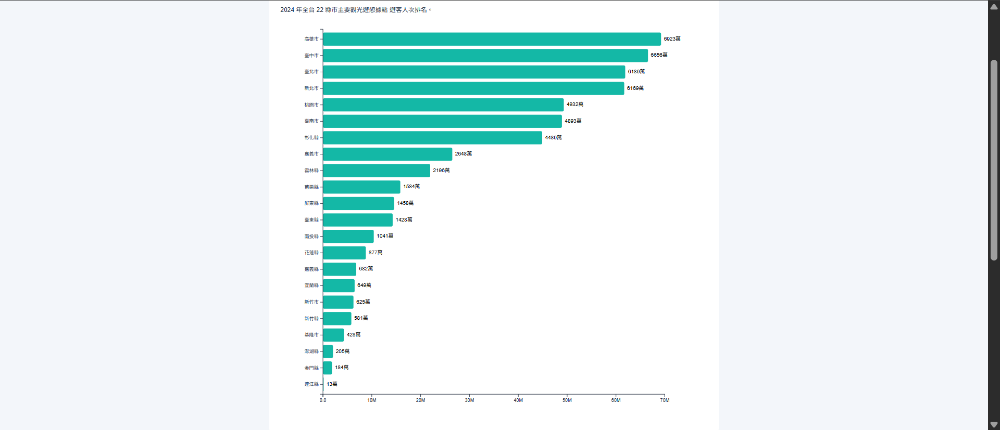
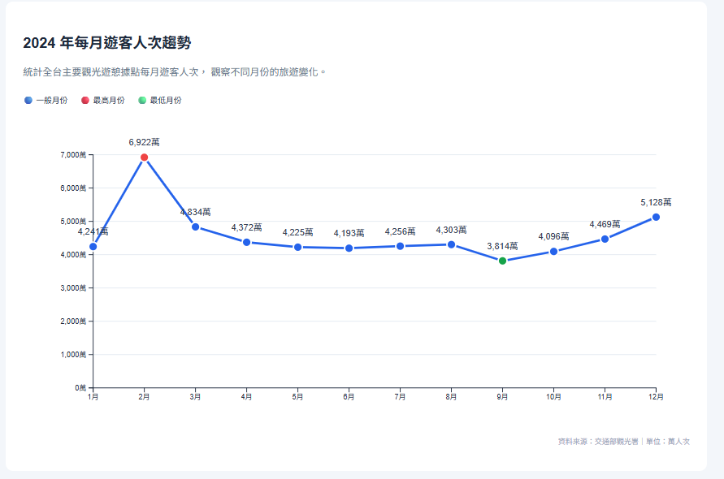

# 2024 年台灣觀光遊憩據點遊客人次視覺化分析

## 一、專案資訊

課程名稱：資料視覺化
作業名稱：HW1 - Static Visualization using D3.js
學號：414085052
姓名：黃浩祐
開發環境：** StackBlitz

## 二、專案介紹

本專案使用交通部觀光署提供的「歷年國內主要觀光遊憩據點遊客人數月別統計」資料，以 2024 年為分析年度，透過 D3.js 製作靜態視覺化圖表。

主要分析以下兩個問題：

1. 2024 年台灣各縣市主要觀光遊憩據點的遊客人次排名為何？
2. 2024 年各月份的遊客人次如何變化？哪個月份最高、哪個月份最低？

透過橫向長條圖與折線圖，呈現觀光遊憩據點的地區分布與月份變化。

## 三、資料來源

- **提供單位：** 交通部觀光署
- **資料名稱：** 歷年國內主要觀光遊憩據點遊客人數月別統計
- **資料平台：** [政府資料開放平台](https://data.gov.tw/)
- **分析年度：** 2024 年
- **資料格式：** CSV
- **資料檔案：** `public/tourism.csv`

主要使用欄位：

| 欄位 | 說明 |
|---|---|
| 年別 | 篩選 2024 年資料 |
| 縣市 | 觀光據點所屬縣市 |
| 合計 | 各據點全年遊客人次 |
| 1月～12月 | 各據點每月遊客人次 |

注意：本資料為主要觀光遊憩據點的造訪人次，不代表所有旅遊活動，也不是不重複旅客人數。

## 四、視覺化成果

### 1. 各縣市遊客人次排行榜

使用 D3.js 橫向長條圖，依各縣市全年遊客人次加總後排序，呈現 22 縣市的比較結果。

**主要功能：**

- 使用 `d3.rollups()` 依縣市分組統計。
- 使用 `d3.sum()` 加總全年遊客人次。
- 使用 `d3.scaleLinear()` 設定 X 軸數值比例。
- 使用 `d3.scaleBand()` 設定 Y 軸縣市位置。
- 依人次由高至低排序，並顯示數值標籤。

**專案截圖：**



### 2. 每月遊客人次趨勢圖

使用 D3.js 折線圖，將 2024 年各月份主要觀光遊憩據點的遊客人次進行加總，觀察全年月份變化。

**主要功能：**

- 使用 `d3.range()` 產生 1 至 12 月資料。
- 使用 `d3.sum()` 統計每月總人次。
- 使用 `d3.scalePoint()` 配置月份 X 軸。
- 使用 `d3.scaleLinear()` 建立人次 Y 軸。
- 使用 `d3.line()` 繪製 SVG 折線。
- 透過不同顏色標示最高及最低月份。

**專案截圖：**



## 五、製作流程

### Step 1：建立專案

使用 StackBlitz 建立 Vue + Vite 專案，並安裝 D3.js：

```bash
npm install d3
```

### Step 2：匯入資料

將交通部觀光署提供的 CSV 檔案放置於 `public` 資料夾，命名為 `tourism.csv`。

透過 `d3.csv()` 讀取資料。

### Step 3：資料前處理

1. 篩選 `年別` 為 2024 的資料。
2. 依縣市名稱進行分組。
3. 加總各縣市全年遊客人次。
4. 統計 1 至 12 月全台遊客人次。
5. 將統計結果轉換為 D3.js 可以繪圖的資料結構。

### Step 4：製作 D3.js 圖表

建立兩個獨立的 Vue Component：

- `BarChart.vue`：繪製縣市遊客人次排行榜。
- `LineChart.vue`：繪製每月遊客人次趨勢圖。

由 `App.vue` 統一讀取資料，再傳入各圖表元件，讓程式架構容易維護。

### Step 5：測試及驗證

於 StackBlitz 執行專案，確認 CSV 能正常載入、兩張圖表正確顯示，並檢查縣市排序及月份數值。

## 六、執行方式

本專案使用 Node.js、Vue 3 與 Vite。

下載專案後，在終端機執行：

```bash
npm install
npm run dev
```

接著依照終端機顯示的網址開啟網頁，通常為：

`http://localhost:5173/`

即可查看兩張 D3.js 視覺化圖表。

## 七、資料分析與觀察

### 1. 縣市遊客人次差異

依照 2024 年主要觀光遊憩據點的資料統計，高雄市的遊客人次最多，其次為臺中市、臺北市、新北市及桃園市。

由於各縣市納入統計的據點數量不同，遊客人次的差異不能直接視為各縣市整體觀光吸引力的排名。

### 2. 月份遊客人次變化

2024 年每月遊客人次呈現變動，其中：

- **最高月份：** 2 月，約 6,922 萬人次。
- **最低月份：** 9 月，約 3,814 萬人次。

從折線圖可觀察到 2 月出現明顯高峰，而 9 月相對較低。假期與季節性因素可能影響旅遊活動，但仍需更多年度資料才能驗證原因。

### 3. 資料限制

本次統計資料存在以下限制：

- 僅涵蓋資料集收錄的主要觀光遊憩據點。
- 同一旅客造訪不同據點可能被重複計算。
- 各縣市統計據點數量不相同。
- 單一年份資料無法充分說明長期旅遊趨勢。

## 八、GitHub 專案連結
網址：
https://github.com/ts719892/1151VIS-HW1-414085052-Huang-HaoYu
